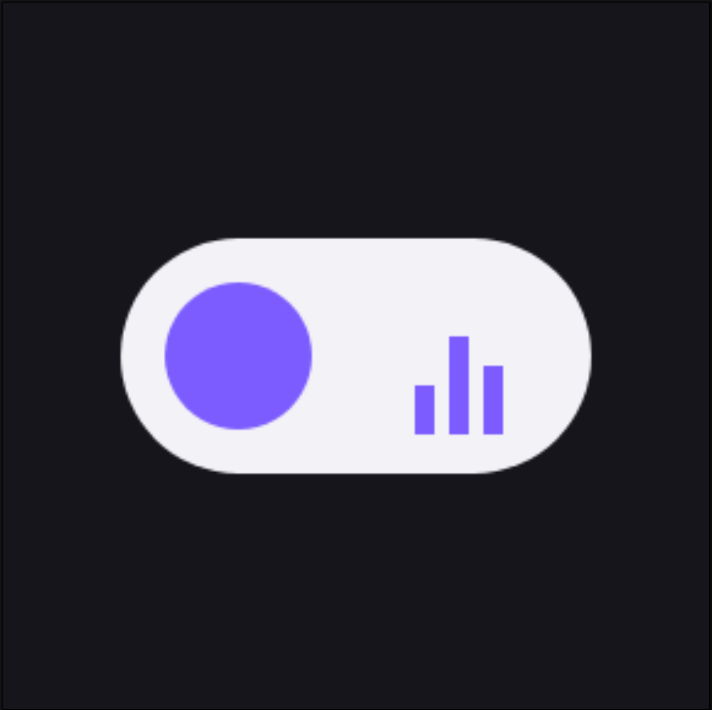
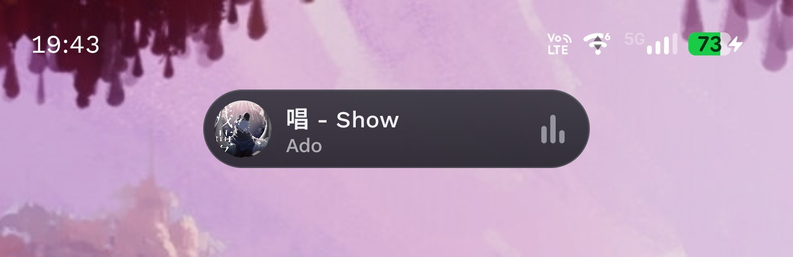
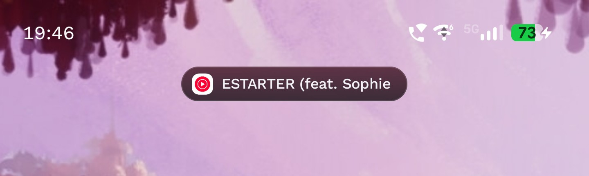
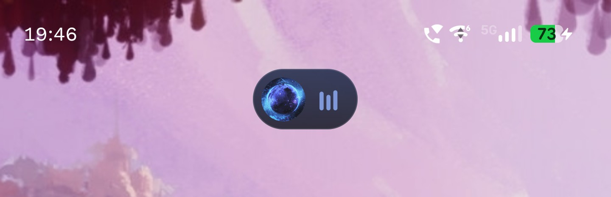
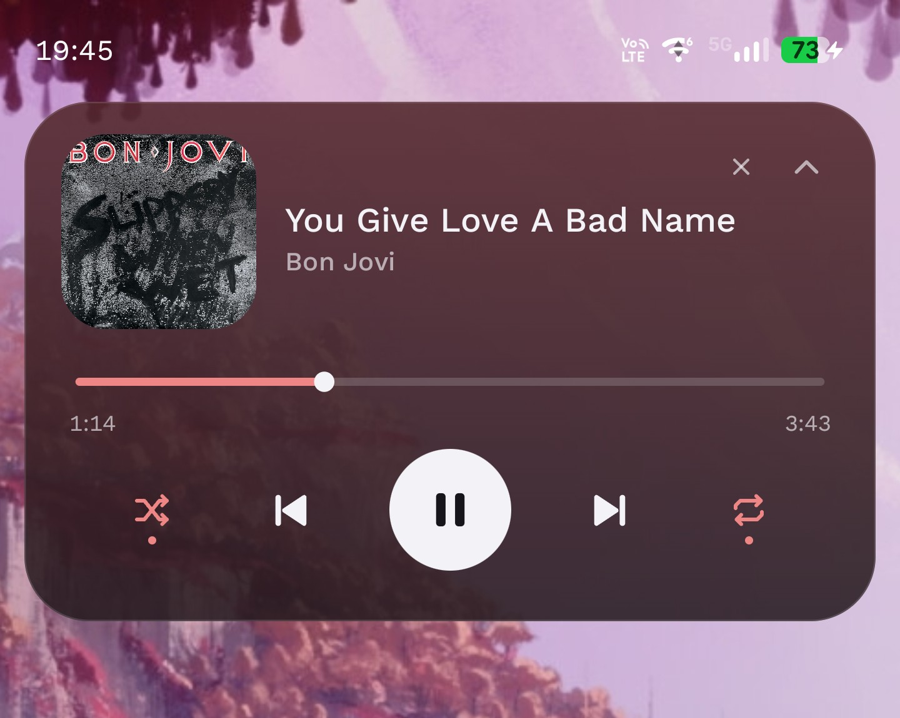

<div align="center">
  
  
  <h1>szczur media bar</h1>
</div>


Własny, animowany pasek muzyczny nad innymi aplikacjami (styl Samsung Now Bar) dla **Motorola Edge 70 Max, Android 16+**.
Aplikacja może działać na innych urządzeniach ale nie testowałem tego. Daj znać na TikToku jeśli działa na innych telefonach. 
Steruje istniejącą sesją multimedialną (YouTube Music, a w przyszłości Spotify/Tidal – kod nie zależy od pakietu aplikacji).
Bez roota, bez Accessibility, bez zewnętrznych serwerów.

## Screenshoty

| Tryb | Podgląd |
| :--- | :---: |
| **Forma Compact (Standard)**<br>Wyświetla okładkę, tytuł, wykonawcę oraz animację wizualizera. |  |
| **Forma Compact (Slim)**<br>Minimalistyczny pasek z ikoną aplikacji oraz tytułem utworu. |  |
| **Forma Compact (Bubble)**<br>Kompaktowy bąbelek z okładką albumu i wizualizerem. |  |
| **Forma Rozszerzona**<br>Pełny panel sterowania z paskiem postępu i przyciskami odtwarzacza. |  |


## Wersje

| Element | Wersja |
|---|---|
| minSdk / targetSdk / compileSdk | 36 / 36 / 36 (Android 16) |
| Android Gradle Plugin | 8.13.0 |
| Gradle | 8.13 |
| Kotlin | 2.2.20 (plugin Compose z tą samą wersją) |
| Compose BOM | 2025.09.01 |
| JDK | 17–24, zalecane 21 (JDK 25 nie działa z Gradle 8.13) |

Android 17 (API 37): projekt celuje w API 36. Pasek powinien działać też na 17, ale nie mam pewnych informacji o zmianach
w API 37 – po aktualizacji telefonu sprawdź obie pozycje z sekcji „Problemy”.

## Architektura

```
app/src/main/java/com/szczurek9/mediabar/
├── MusicBarApp.kt                    Application: PreferencesRepository + referencja do kontrolera nakładki
├── MainActivity.kt                   Ekran konfiguracji i ustawień
├── media/
│   ├── MusicNotificationListener.kt  NotificationListenerService: dostęp do sesji + host nakładki
│   ├── MusicSessionManager.kt        Wykrywanie sesji, wybór aktywnej, sterowanie (play/pause/next/prev/seek)
│   ├── MusicMetadataRepository.kt    MediaMetadata + PlaybackState -> NowPlaying (z wartościami zastępczymi)
│   └── NowPlaying.kt                 Model danych
├── overlay/
│   ├── MusicOverlayController.kt     Okno WindowManager (TYPE_APPLICATION_OVERLAY), widoczność, pozycja, przeciąganie
│   ├── DragContainer.kt              Przeciąganie okna bez kolizji z klikaniem i paskiem postępu
│   ├── MusicBar.kt                   Korzeń Compose: motyw, skala, przejście compact <-> expanded
│   ├── MusicBarCompact.kt            Mały pasek
│   ├── MusicBarExpanded.kt           Pełny panel
│   ├── BarComponents.kt              Okładka, equalizer, ikony, pasek postępu
│   ├── BarTheme.kt                   Paleta + kolory z okładki (Palette)
│   └── OverlayState.kt               Stan UI + interfejs akcji
├── settings/
│   ├── BarSettings.kt                Model ustawień
│   ├── PreferencesRepository.kt      DataStore
│   └── MusicBarSettings.kt           Ekran ustawień (Compose)
├── foreground/ForegroundAppDetector.kt  Aplikacja na ekranie (UsageStatsManager) – auto-ukrywanie
├── permissions/PermissionManager.kt  Sprawdzanie uprawnień i przejścia do ustawień Androida
└── tile/MusicBarTileService.kt       Kafelek szybkich ustawień (ukryj/pokaż pasek)
```

Świadome odstępstwa od proponowanego podziału:

* **Brak osobnego Foreground Service.** Nakładkę hostuje `MusicNotificationListener`, który system sam podpina (też po restarcie telefonu) tak długo, jak Dostęp do powiadomień jest przyznany. Dzięki temu nie ma ograniczeń Androida 14/15+ na start usług pierwszoplanowych z tła, nie ma stałego powiadomienia i nie trzeba `BOOT_COMPLETED`.
* **Brak prawdziwego blura tła.** `FLAG_BLUR_BEHIND` rozmywa prostokąt całego okna (rogi byłyby kwadratowe), a okno nakładki nie ma `setBackgroundBlurRadius`. „Szkło” to półprzezroczysty gradient z kolorem okładki i cienką obwódką.
* Teksty ekranu ustawień są wpisane po polsku w kodzie (aplikacja jednojęzyczna); teksty serwisów i kafelka są w `strings.xml`.

## Obsługa

* Dotknięcie małego paska – rozwija panel. Strzałka w górę – zwija.
* Przeciąganie palcem (poza paskiem postępu) – przesuwa panel; pozycja jest zapamiętywana.
* Długie przytrzymanie małego paska albo „X” w panelu – tymczasowe ukrycie. Pasek wraca przy następnym utworze/wznowieniu (opcja „Pokazuj automatycznie”), z kafelka szybkich ustawień albo przyciskiem „Pokaż pasek” w aplikacji.
* Pasek widać tylko gdy jest sesja multimedialna; po pauzie zachowuje się według ustawienia „Po zatrzymaniu muzyki”.
* Nakładka nie jest pokazywana na ekranie blokady (ograniczenie Androida) – wraca po odblokowaniu.

## Formy i opcje

* **Forma paska kompaktowego** (Ustawienia → Pasek): *Standard* (okładka, tytuł, wykonawca, equalizer), *Slim* (ikona aplikacji odtwarzacza i tytuł, wąska pastylka), *Bubble* (okładka i equalizer). Tytuł w Standard i Slim przewija się automatycznie, gdy się nie mieści.
* **Rozwinięty panel** zajmuje całą szerokość ekranu (z odstępem 12 dp po bokach). Dotknięcie poza panelem zwija go do formy kompaktowej. Dotknięcie okładki lub tytułu otwiera aplikację, z której gra muzyka.
* **Shuffle / repeat** po bokach przycisków sterowania. Android nie ma na to standardowego polecenia, więc działają tylko, gdy aplikacja zgłasza własne akcje sesji (rozpoznawane po nazwie: shuffle/losow…, repeat/loop/powtarz…). W przeciwnym razie ikony są przygaszone. Sprawdź kartę **Diagnostyka sesji** na dole ustawień – pokazuje, co zgłasza twoja aplikacja.
* **Pozycja:** siatka 3×3 (poziomo lewo/środek/prawo, pionowo góra/środek/dół). Wiersz decyduje o kierunku rozwijania: góra – w dół, dół – w górę, środek – w obie strony. „Zablokuj przesuwanie palcem” przypina pasek do pola. „W linii paska statusu” (górny rząd) umieszcza pastylkę w pasku statusu.
* **Auto-ukrywanie w aplikacji odtwarzacza:** gdy na ekranie jest aplikacja, z której gra muzyka (np. film w YouTube), pasek znika. Wymaga uprawnienia „Dostęp do danych o użyciu” (Ustawienia → Aplikacje specjalne). Aplikacja na ekranie jest sprawdzana co ok. 1,5 s i tylko wtedy, gdy gra sesja i opcja jest włączona.

Ograniczenia:

* Zwykła nakładka zawsze leży **pod rozwiniętym panelem powiadomień** – tego nie da się obejść bez usługi dostępności. Pastylka (najlepiej Slim) w linii paska statusu jest widoczna, gdy panel jest zwinięty.
* Przy dostępie do danych o użyciu system może wymagać wcześniejszego „Zezwól na ustawienia z ograniczeniami” (jak przy powiadomieniach).

## Budowanie (Windows)

### 1. Android Studio i SDK
1. Pobierz Android Studio z https://developer.android.com/studio i zainstaluj (domyślne opcje).
2. Przy pierwszym uruchomieniu kreator pobierze SDK. Potem: **More Actions → SDK Manager → SDK Platforms** i zaznacz **Android 16 (API 36)** (jeśli nie ma, zaznacz „Show Package Details” i wybierz „Android SDK Platform 36”). W zakładce **SDK Tools** upewnij się, że są: *Android SDK Build-Tools*, *Platform-Tools*. Kliknij Apply.

### 2. Otwarcie i synchronizacja
1. **File → Open** i wskaż folder `szczur-media-bar` (ten z `settings.gradle.kts`).
2. Poczekaj na **Gradle Sync** (pobiera zależności, pierwszy raz kilka minut).
3. Jeśli Studio zaproponuje aktualizację AGP/Gradle/Kotlin – możesz odmówić albo zaakceptować; projekt jest przygotowany na wersje z tabeli wyżej.

### 3. Kompilacja z terminala
Otwórz PowerShell w folderze projektu. Przy pierwszym użyciu ustaw JDK i ścieżkę SDK:

```powershell
$env:JAVA_HOME = "C:\Program Files\Eclipse Adoptium\jdk-21.0.8.9-hotspot"   # Twój folder JDK 21
# jeśli nie ma pliku local.properties (Studio tworzy go samo przy otwarciu projektu):
"sdk.dir=$env:LOCALAPPDATA\Android\Sdk".Replace('\','\\') | Out-File -Encoding ascii local.properties

.\gradlew.bat assembleDebug
```

Linux/macOS: `./gradlew assembleDebug`

APK: `app\build\outputs\apk\debug\app-debug.apk`

Wersja „release” (szybsza, nie debugowalna, podpisana kluczem debug – tylko do własnego użytku):
`.\gradlew.bat assembleRelease` → `app\build\outputs\apk\release\app-release.apk`

Czyszczenie: `.\gradlew.bat clean`

### 4. Instalacja na Motoroli
**Przez USB:** na telefonie włącz *Opcje programisty* (Ustawienia → Informacje o telefonie → kilka razy „Numer kompilacji”), potem *Debugowanie USB*. Podłącz telefon, zaakceptuj klucz RSA i:

```powershell
& "$env:LOCALAPPDATA\Android\Sdk\platform-tools\adb.exe" install -r app\build\outputs\apk\debug\app-debug.apk
```

**Bez kabla:** skopiuj APK na telefon, otwórz go w menedżerze plików i zezwól przeglądarce/menedżerowi na instalację z nieznanych źródeł. Z Android Studio możesz też po prostu kliknąć **Run ▶** przy podłączonym telefonie.

### 5. Uprawnienia (jednorazowo)
Uruchom aplikację – ekran główny pokazuje status i prowadzi do właściwych ustawień:

1. **Wyświetlanie nad innymi aplikacjami** → Przyznaj → włącz przełącznik.
2. **Ustawienia z ograniczeniami (tylko APK z sideloadu):** Ustawienia aplikacji → menu ⋮ w prawym górnym rogu → **Zezwól na ustawienia z ograniczeniami**. Bez tego kroku przełącznik dostępu do powiadomień jest wyszarzony.
3. **Dostęp do powiadomień** → Przyznaj → włącz „szczur media bar”.
4. **Dostęp do danych o użyciu** (opcjonalnie, do auto-ukrywania) → Przyznaj → włącz „szczur media bar”.
5. Wróć do aplikacji – pozycje powinny pokazywać „OK”, a „Usługa nasłuchu połączona” też.

### 6. Działanie w tle na Motoroli
* Ustawienia → Aplikacje → szczur media bar → **Bateria** → **Bez ograniczeń** (albo przycisk „Zmień” w aplikacji).
* Jeśli używasz „Adaptacyjnej baterii” lub oszczędzania energii, wyłącz je dla tej aplikacji.
* Nie „zamykaj” aplikacji przez wyczyszczenie ostatnich – nie jest to potrzebne i na niektórych wersjach nakładki Motoroli może zatrzymać serwis.

## Problemy

| Objaw | Co zrobić |
|---|---|
| Brak paska mimo grającej muzyki | Sprawdź obie pozycje „OK” na ekranie głównym. Włącz muzykę w YouTube Music i poczekaj chwilę – pasek pojawia się, gdy jest aktywna sesja. Sprawdź też przełącznik „szczur media bar włączony” i kafelek (czy nie jest ukryty). |
| Przełącznik dostępu do powiadomień wyszarzony | Krok 2 z sekcji Uprawnienia (ustawienia z ograniczeniami). |
| „Usługa nasłuchu” = Brak, mimo przyznanego dostępu | Wyłącz i włącz Dostęp do powiadomień dla aplikacji; na ekranie głównym aplikacja sama prosi system o ponowne podpięcie przy wejściu. |
| Pasek znika po jakimś czasie | Bateria → Bez ograniczeń; sprawdź też „Po zatrzymaniu muzyki” (domyślnie ukrywa po 20 s pauzy). |
| Brak okładki | Pokazywana jest ikona „♪”. Okładka musi być w metadanych sesji (bitmapa lub lokalne URI); adresów internetowych celowo nie pobieramy. |
| Przewijanie nie działa | Pasek postępu jest nieaktywny, gdy utwór nie ma znanej długości (np. transmisja na żywo) albo sesja nie zgłasza akcji przewijania. |
| Przyciski paska działają, ale „Poprzedni” restartuje utwór | To zachowanie YouTube Music (po kilku sekundach „Poprzedni” wraca na początek utworu). |
| `SDK location not found` | Utwórz `local.properties` z `sdk.dir=...` (patrz krok 3) albo otwórz projekt w Android Studio. |
| Błąd `25.0.3` / `Unsupported class file major version` | Gradle 8.13 nie obsługuje JDK 25. Zainstaluj JDK 21 (`winget install EclipseAdoptium.Temurin.21.JDK`) i ustaw na niego `JAVA_HOME`. |
| Błąd kompilacji | Wklej pełny komunikat – podam poprawkę z numerami linii. Kod nie był kompilowany w tym środowisku (brak Android SDK). |
